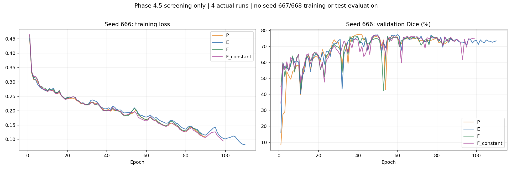
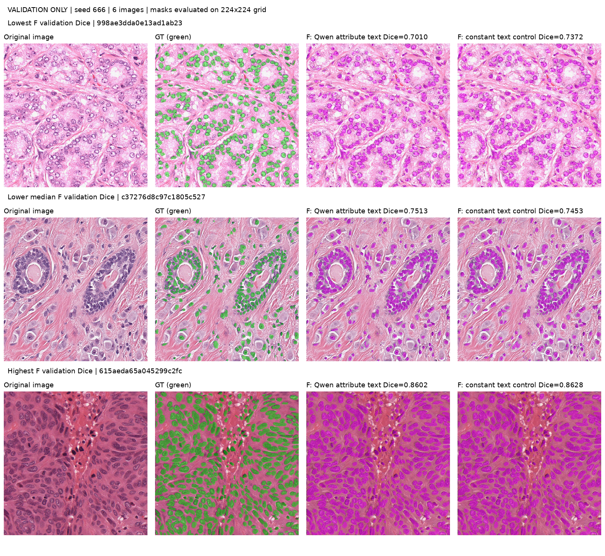

# 阶段4.5结果：完成筛选，因文本退化提前停止

日期：2026-11-01。云端目录：`/root/autodl-tmp/Qwen2.5-VL-3B-LViT`。

## 结论与完成范围

已实现并执行属性描述、完整BERT编码、单层交叉注意力、P/E/F筛选和F固定文本对照，共 **4/18次正式训练**，全部为seed666。独立运行审查11项通过，另通过编码、融合梯度和24份验证预测PNG重算检查。

**本轮没有达到改进目标，不进入阶段五。** 30张训练/验证图的描述全部相同，打乱对应关系不改变数值输入；LoRA启动门槛亦未满足。因此依据用户计划中“证据不支持时停止扩展”提前结束，停止点早于原定三种子确认。

未执行：seed667/668正式训练、三个匹配对照的三种子确认、LoRA与下游D、新测试描述及测试集最终复测。剩余14个名额未使用，也不转用于增加搜索。不能将本轮表述为全部18次实验完成或三种子验证门槛已测定。条件LoRA和最终测试分支尚未实现并验收为可直接执行的完整流程；本次交付覆盖实际到达的筛选和停止分支。

## 属性描述与编码

覆盖阈值只由24张训练原图掩码的前景面积确定，三分位数为 **0.24187533 / 0.31370767**；位置使用原尺寸四象限前景占比，max-min<0.05为uniform，平分顺序左上、右上、左下、右下。属性不是细胞计数或医学诊断。

Qwen仅接收图像和冻结定义。30条原始回答均为`coverage=high, location=unknown`，句子均为：

> Nuclei coverage high concentration unknown

| 划分 | 图数 | coverage正确 | location正确 | 两字段平均准确率 | 完整匹配 |
|---|---:|---:|---:|---:|---:|
| train | 24 | 8/24 | 0/24 | 16.67% | 0/24 |
| val | 6 | 2/6 | 0/6 | 16.67% | 0/6 |

所有原始回答带JSON围栏，直接JSON解析率0/30；按运行前记录的单层完整围栏剥离规则，字段/枚举合法30/30。unknown来自模型回答，没有利用GT补值。此适配与“任何格式偏差一律转unknown”的最严格解释不同，已保留两种解析状态；若严格拒绝围栏，两字段都会成为unknown，仍然没有图像间差异。

30张图的ID、文件hash与缓存一一对应；事后独立重放处理器输入，30个pixel_values指纹全部不同，排除了读成同一张图的管线错误。重放不是原运行中采集的输入跟踪。两种编码下的30份文本特征分别逐元素一致。

完整编码冻结同一BERT，最多64位置，移除特殊符号/padding、合并WordPiece，无EOF XXX补词，对全部有效位置池化到10。独立测试短句、WordPiece及长句，核对池化窗口、末尾词改变输出以及超长明确报错。缓存保留实际token和版本。

## 四次真实筛选

下表均是 **seed666、6张验证图的逐图宏平均**，不是测试成绩，不可与原测试Dice77.5412%直接比较。

| 条件 | 验证Dice% | 验证IoU% | 实际 / 最佳epoch | 训练墙钟秒 | allocated / reserved峰值GiB |
|---|---:|---:|---:|---:|---:|
| P | 77.3586 | 63.3897 | 90 / 40 | 277.44 | 2.735 / 3.227 |
| E | 77.2854 | 63.2575 | 110 / 60 | 337.54 | 2.735 / 3.227 |
| F | 76.3872 | 62.1269 | 88 / 38 | 279.95 | 2.735 / 3.227 |
| F_constant | 77.1216 | 63.0722 | 99 / 49 | 308.99 | 2.735 / 3.227 |

P为新描述+原编码+原融合，E仅改完整编码，F再改单层交叉注意力。P/E初始分割权重相同，F与F_constant初始权重相同；训练顺序、优化器、学习率、损失、预处理和max2000/min50/patience50不变。四次都因连续50个epoch无更好验证Dice停止。

按0.1个百分点内优先简单方案的规则，筛选候选为 **P**。P与E差约0.0732个百分点；这只是筛选记录，不构成最终模型验收。

## LoRA门槛与提前停止依据

| 条件 | 要求 | 实测 | 结果 |
|---|---:|---:|---|
| F减固定文本验证Dice | ≥0.3个百分点 | -0.7344个百分点 | 未通过 |
| 正确配对减五种打乱均值 | ≥0.2个百分点 | +0.0000个百分点 | 未通过 |
| Qwen验证属性字段准确率 | <80% | 16.67% | 满足 |

三项须同时满足，实际不满足。未安装PEFT或创建480视图，未做LoRA兼容性/显存试跑或训练，LoRA成本为0。没有通过降低门槛绕开失败。

对666/667/668预定映射分别检查30个train/val样本：ID均在各自划分内错位，但重复文本令 **30/30配对的文本和特征数值不变**。这是输入等价性证明，绝不是三个种子已训练的结果。在配对控制的相同初始化和顺序下，继续打乱对照无法建立图像特异文本增益，因此提前停止扩展。

固定对照使用24张训练特征的浮点均值。即使原特征相同，求均值也产生约1e-6量级舍入差，长期训练的轨迹和停止点可以不同；F与固定对照差异不能被解释为图像特异文本信息的效果。

“先证明文本有效才允许改善文本”的条件在常量输出时无法开启LoRA，暴露了方案的冷启动限制。但零打乱敏感性并不证明交叉注意力对有信息文本无效。

## 工程核验与预测错误

F实际注入张量为图像`[2,196,64]`与文本`[2,10,64]`，4头、LayerNorm、g初值0.1；保留原投影链，仅改第一层。交叉注意力各参数均有有限非零梯度，人工文本扰动能改变输出。这是接线核验，不是语义有效性证据。

旧版90份已跟踪文件和7份新训练核心文件hash不变。运行前核验旧前向兼容与保存重载后下一步模型/Adam状态完全一致。失败正式训练也占名额，同配置恢复不重复计数。

以下包含全部6张验证图，FP/FN为224×224网格像素数，不是核实例数。四模型24份预测PNG已独立重算Dice/IoU并与选模结果一致。

| 样本ID | F Dice% | 固定Dice% | 差值pp | F FP / FN | 固定 FP / FN |
|---|---:|---:|---:|---:|---:|
| 998ae3dda0e13ad1ab23 | 70.102 | 73.724 | -3.621 | 1576 / 4249 | 2104 / 3382 |
| 02185f96dc0e6a4100d2 | 70.138 | 69.571 | +0.567 | 6355 / 1071 | 6657 / 1018 |
| c37276d8c97c1805c527 | 75.126 | 74.525 | +0.600 | 1936 / 1132 | 2431 / 897 |
| aaa5770dbc460c55562e | 77.511 | 78.895 | -1.384 | 7849 / 1168 | 6679 / 1472 |
| d93f2c167af993de1702 | 79.424 | 79.730 | -0.306 | 3652 / 821 | 3116 / 1121 |
| 615aeda65a045299c2fc | 86.022 | 86.284 | -0.262 | 3237 / 2472 | 3262 / 2359 |

展示按F Dice选最差、下中位及最佳，不按改善幅度挑图。目视核验：最差病例存在局部漏检，F的FN为4249像素、固定对照3382，尽管F的FP更少，Dice仍低3.621个百分点；下中位病例密集区域有相邻前景连片，F减少FP但增加FN，净改善仅0.600个百分点；最佳病例两者覆盖主要前景，Dice差仅-0.262个百分点。图像只作验证案例解释，不能用于推导核计数或临床结论。P/E全部逐图预测亦保留云端。

## 成本、偏差和未验证范围

四次训练墙钟合计 **1203.92秒（20.07分钟）**。Qwen生成累计49.71秒；单图generate平均1.657秒、中位1.643秒、范围1.539–2.506秒，不含加载和预处理。生成峰值allocated为7.525GiB、reserved为7.754GiB。

生成器在最后一条描述保存后遇到监控关闭接口错误；已修复为close并归档原源码，核验30条后恢复完成凭据，没有重生成或选择答案。无法恢复的加载/总墙钟保留null；逐图耗时、显存和GPU采样仍保留。原缓存指纹引用当时源码，不冒充修复后生成。

验证导出耗时包含batch2、PNG写入和首轮冷启动，不当作纯单图性能比较。完整Qwen→分割端到端/同时驻留性能、PEFT0.15.2兼容性、LoRA冻结与保存重载均未进入验证范围。补充编码审查初版使用不同batch形状比较BERT浮点输出而触发过严断言，已改为相同batch下独立计算池化窗口；不涉及修改编码器或训练产物。

后续应重新约定计划，先检验属性可预测性和有信息属性能否改善分割，可考虑GT属性参考上界与小规模监督适配。这些未执行，且GT上界必须与可部署预测区分，不能把验证/测试GT作为正常推理输入。当前证据不足以进入空间融合或宣称增大模型即可提升Dice。

## 文件与复现

- [执行计划](阶段4.5执行计划.md)与[状态](phase45_status.json)。
- [预算登记](phase45_evidence/registry.json)、[运行审查](phase45_evidence/final_audit.json)。
- [编码检查](phase45_evidence/encoding_audit.json)、[文本敏感性](phase45_evidence/F_sensitivity.json)、[LoRA门槛](phase45_evidence/lora_gate.json)。
- [逐图指标](phase45_evidence/per_image_validation.csv)；各次配置、历史和指纹见`phase45_evidence/*_seed666/`。
- 云端`outputs/phase45/runs/*/best.pt`、`last.pt`保留检查点，原始描述位于`cache/phase45/attributes_base_development.jsonl`。

本轮未产生新测试成绩，因此测试Dice≥78.5412%、IoU≥63.4906%及三种子匹配控制成功标准均未验证。未来若重启测试，必须称“原划分上的最终复测”，不能称新盲测。
