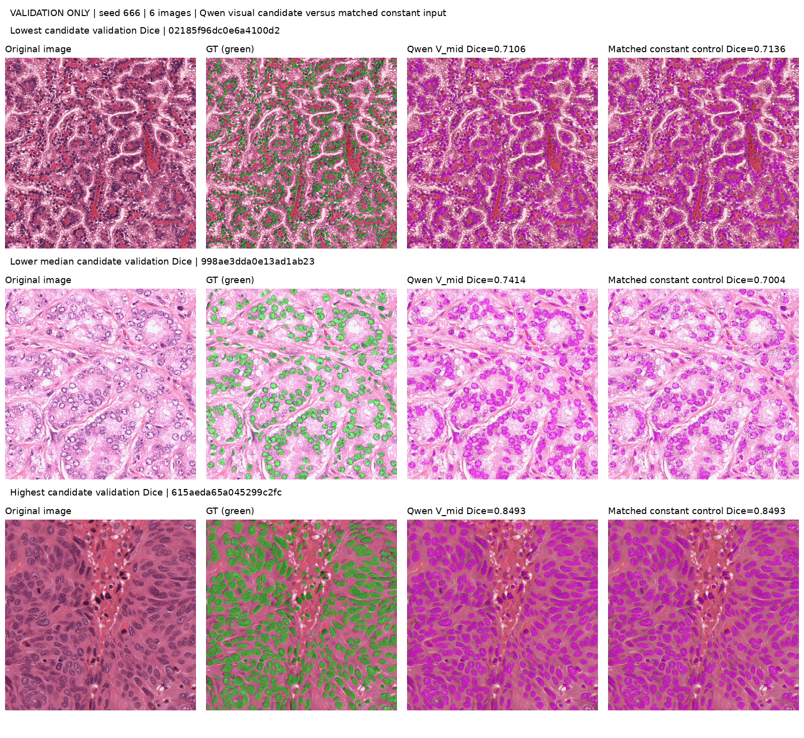
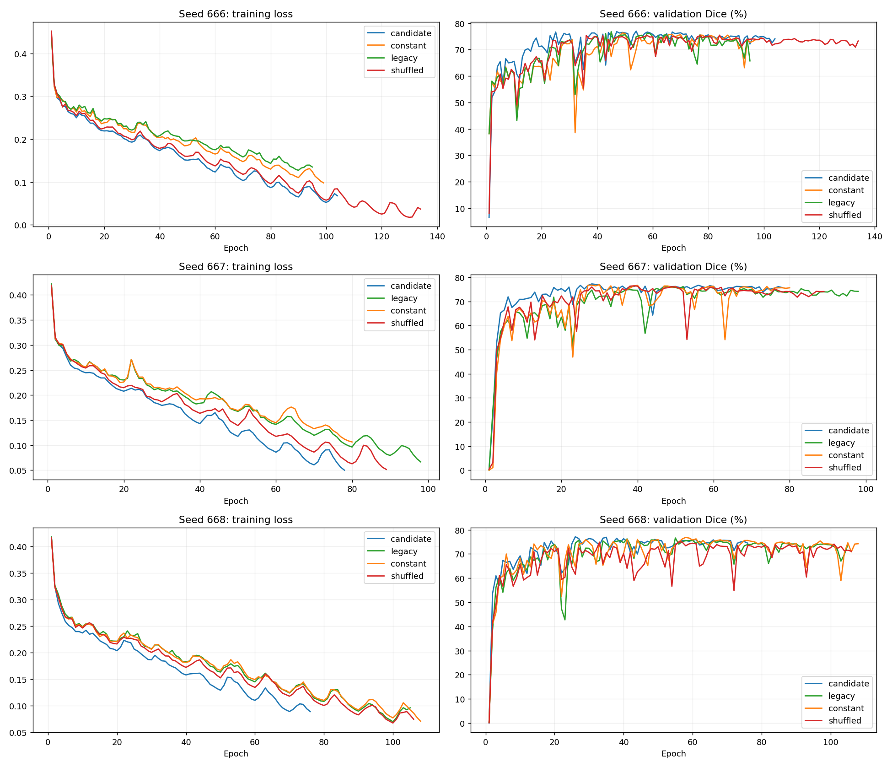
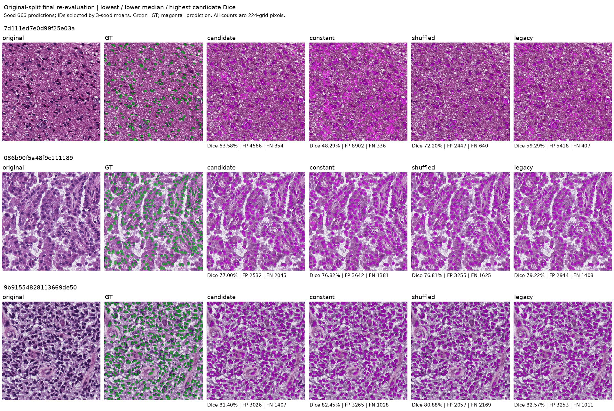
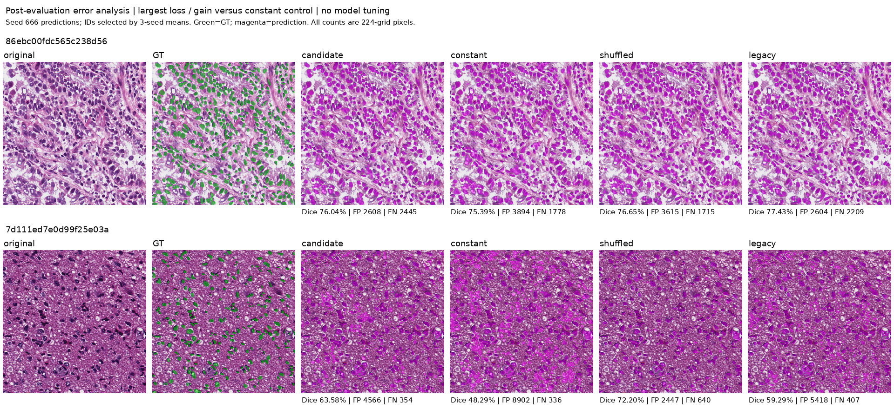
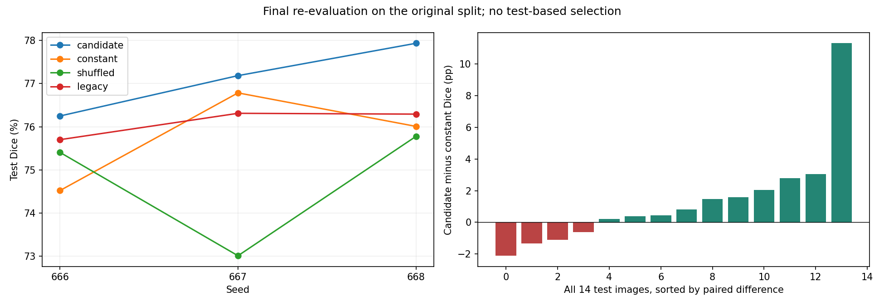

# 阶段4.6：Qwen描述与视觉特征实验结果

本报告由真实运行记录生成；日期：2026-11-02T01:05:18+08:00。

## 结论与完成边界

**未达到全部预定门槛，不能宣称目标已完成。**已完成四组条件各三种子的原划分最终复测；这14张测试图此前已查看，不称为新的盲测。

本轮的正负结论仅针对MoNuSeg 24/6/14。Qwen视觉路线使用冻结预训练视觉塔，不证明自然语言描述或医学推理的贡献。cov19、MosMedData尚未完成本轮正式实验。

本轮正式训练13次，加旧阶段4.5的4次，共17/18次；S提示筛选未通过，不消耗正式训练名额。未用名额不自动转为额外搜索。LoRA未启动，训练成本为0。

## 候选与匹配对照

S在每个查询中提供三张训练示例，训练查询排除自身；30条回答仍为相同的high/unknown，验证字段准确率2/12，故跳过分割训练。V_mid使用视觉塔第16个block、1280维特征；V_merged使用最终merger、2048维特征。两者恢复空间顺序后池化到28×28，通过门控轻量卷积分支注入LViT最后解码特征。

| seed666候选 | 最佳验证Dice% |
|---|---:|
| V_mid | 77.0171 |
| V_merged | 75.9839 |

按预先规则选择V_mid；没有用测试成绩选择层或超参数。四组条件如下：

| 条件 | 视觉输入 | 文本输入 |
|---|---|---|
| candidate | 对应图像的Qwen特征 | 24张训练原文的均值 |
| constant | 24张训练视觉特征的逐位置均值 | 同一训练文本均值 |
| shuffled | 各划分内部固定错位的视觉特征 | 同一训练文本均值 |
| legacy | 同一训练视觉均值 | 对应图像的原有文本 |

固定特征均不使用验证或测试均值。打乱偏移为1+seed%(划分大小-1)，不跨划分交换。同一种子的四组初始权重指纹相同。LViT图像仍为BGR224，Qwen图像输入上限1003520像素，新增分辨率和预训练资源需要披露；尚无与其他专业视觉编码器的公平比较。原文本来源未独立证实。

## 三种子验证结果

| 条件 | seed666 Dice% | seed667 Dice% | seed668 Dice% | 均值±样本标准差% |
|---|---:|---:|---:|---:|
| candidate | 77.0171 | 77.2535 | 77.1022 | 77.1243 ± 0.1198 |
| legacy | 76.8343 | 76.2431 | 76.6108 | 76.5627 ± 0.2985 |
| constant | 76.3099 | 76.9356 | 76.8438 | 76.6964 ± 0.3379 |
| shuffled | 75.4713 | 76.4453 | 74.9852 | 75.6339 ± 0.7435 |

验证仅6张图，种子间标准差不代表跨病例总体不确定性，不作统计显著性结论。

| 验证门槛 | 结果 |
|---|---|
| beats_constant | 通过 |
| beats_shuffled | 通过 |
| not_below_legacy | 通过 |

已训练candidate666的五种验证错位使Dice平均下降6.5311个百分点。这说明推理依赖特征；它与重新训练的shuffled对照是不同证据，不能相互替代。

所有开发决策只用训练/验证；FP32 Adam、学习率0.001、batch2、损失、无几何增强、max2000/min50/patience50和最佳验证Dice最早选模均保持冻结。

## 全部正式运行与成本

| 运行 | 验证Dice% | 验证IoU% | 实际/最佳epoch | 训练秒 | allocated/reserved峰值GiB |
|---|---:|---:|---:|---:|---:|
| V_mid_seed666 | 77.0171 | 62.8766 | 104/54 | 338.67 | 2.745/3.369 |
| V_merged_seed666 | 75.9839 | 61.4629 | 108/58 | 354.77 | 2.752/3.381 |
| confirm_constant_seed666 | 76.3099 | 61.9570 | 99/49 | 320.86 | 2.745/3.369 |
| confirm_candidate_seed667 | 77.2535 | 63.1658 | 78/28 | 256.14 | 2.745/3.369 |
| confirm_candidate_seed668 | 77.1022 | 62.9794 | 76/26 | 247.36 | 2.745/3.369 |
| confirm_legacy_seed666 | 76.8343 | 62.6111 | 95/45 | 311.60 | 2.745/3.369 |
| confirm_legacy_seed667 | 76.2431 | 61.8910 | 98/48 | 324.32 | 2.745/3.369 |
| confirm_legacy_seed668 | 76.6108 | 62.2613 | 105/55 | 346.21 | 2.745/3.369 |
| confirm_constant_seed667 | 76.9356 | 62.7340 | 80/30 | 263.84 | 2.745/3.369 |
| confirm_constant_seed668 | 76.8438 | 62.6850 | 108/58 | 339.38 | 2.745/3.369 |
| confirm_shuffled_seed666 | 75.4713 | 60.8428 | 134/84 | 422.72 | 2.745/3.369 |
| confirm_shuffled_seed667 | 76.4453 | 62.0398 | 89/39 | 278.74 | 2.745/3.369 |
| confirm_shuffled_seed668 | 74.9852 | 60.2299 | 106/56 | 330.13 | 2.745/3.369 |

本轮分割训练墙钟合计4134.74秒（68.91分钟），不含Qwen/BERT缓存生成、文件校验、分析与模型加载。

30张训练/验证图的双层视觉缓存与三示例属性生成，生成器记录墙钟78.12秒，含模型加载2.75秒，不含进程启动和此前模型文件hash。视觉提取平均0.3692秒/图，属性generate平均1.5945秒/图。属性生成显存allocated/reserved峰值8.034/8.449GiB。分步计时的边界与端到端测速不同，不简单相加为服务延迟。

第一张验证图batch1，完整Qwen权重与LViT同时驻留，两次预热后10次实测：平均端到端0.5307秒，视觉提取0.3431秒，分割及二值图CPU传输0.0169秒；显存allocated/reserved峰值7.422/7.678GiB。模型加载5.32秒单列。常量训练文本已预载，不运行语言解码器；端到端含图像读取/预处理，不含输出写盘或初始文件hash。缓存与实时视觉特征、分割概率逐元素一致。

## 独立核验与逐图结果

开发审查通过18项，复核旧文件与冻结核心、运行预算、最早最佳epoch、早停、配置/缓存/检查点指纹和同种子初始权重。全部四组×三种子×六张验证预测共72份PNG独立重算通过。

## 原划分最终复测

| 条件 | 测试Dice均值±SD% | 测试IoU均值±SD% |
|---|---:|---:|
| candidate | 77.1226 ± 0.8439 | 62.9308 ± 1.0602 |
| constant | 75.7721 ± 1.1497 | 61.3943 ± 1.2819 |
| shuffled | 74.7337 ± 1.5013 | 59.9097 ± 1.7721 |
| legacy | 76.1021 ± 0.3472 | 61.6629 ± 0.3768 |

旧原文本基线测试Dice为77.5412%，IoU为63.4906%；本轮候选分别低0.4186和0.5598个百分点。相同新结构的原文本对照也低于旧基线，不能把视觉特征相对新对照的提升解释为整套框架超过原方案。本轮未分别隔离原文本编码变化和融合结构变化的因果影响。

| 条件 | seed | 测试Dice% | 测试IoU% |
|---|---:|---:|---:|
| candidate | 666 | 76.2495 | 61.8396 |
| candidate | 667 | 77.1843 | 62.9957 |
| candidate | 668 | 77.9340 | 63.9570 |
| constant | 666 | 74.5224 | 59.9731 |
| constant | 667 | 76.7850 | 62.4633 |
| constant | 668 | 76.0088 | 61.7465 |
| shuffled | 666 | 75.4084 | 60.6597 |
| shuffled | 667 | 73.0134 | 57.8860 |
| shuffled | 668 | 75.7793 | 61.1834 |
| legacy | 666 | 75.7014 | 61.2296 |
| legacy | 667 | 76.3119 | 61.9147 |
| legacy | 668 | 76.2930 | 61.8443 |

| 成功条件 | 结果 |
|---|---|
| dice_target | 未通过 |
| iou_target | 未通过 |
| beats_fixed | 通过 |
| beats_shuffled | 通过 |
| not_below_matched_legacy | 通过 |
| two_seeds_improved | 未通过 |

三个种子相对旧原文本基线的Dice差值（百分点）：{"666": -1.7364766699081824, "667": 0.7865157847887105, "668": -0.30585704397442237}。

独立重算168份新预测和42份旧原文本基线预测，共210份PNG；复算三种子均值、SD及全部六项成功条件。未根据复测结果重新选择候选或调整配置。

## 证据位置与剩余边界

- 云端：`outputs/phase46/registry.json`、`confirmation/summary.json`、`development_audit.json`、`visual_review/`、`validation_paired_per_image.csv`。
- 若已复测：`final_test/independent_audit.json`、`audited_per_image.csv`、各组各种子的预测PNG与metrics。
- 计划、代码及配置纳入Git；数据、模型、缓存和检查点不纳入Git。
- 图表生成不等于目视验收；最终人工/主代理看图记录另存，不能声称临床有效性。
- 若数值门槛未全通过，保留当前瓶颈与后续假设，不降低门槛，不以单种子或单张改善宣称成功。更细空间特征、任务监督和其他视觉骨干比较仍是待检验假设。

主代理已实际打开图表核验，详见[视觉核验与失败案例](阶段4.6视觉核验.md)。图中展示seed666，案例按三种子均值选取，二者不可混淆。
