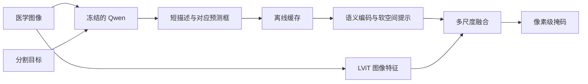

# Qwen2.5-VL-3B + LViT 项目任务路线与实验计划

更新日期：2026-11-01  
云端项目目录：/root/autodl-tmp/Qwen2.5-VL-3B-LViT  
计划依据：会话“查找第三篇论文创新基线”与“评估云服务器双模型部署”中的研究讨论、当前方案选择及云端实测结果。

## 1. 项目目标与研究问题

以 LViT 为第一个分割骨干，使用 Qwen2.5-VL-3B-Instruct 生成图像证据，借鉴 GCoT 中证据与图像区域对应的思路，研究语义和空间信息如何改善医学图像的像素级分割。

核心研究问题：

> 多条短描述与对应定位框，通过多尺度融合进入分割特征后，能否在普通描述和单个粗定位框之外，带来稳定、可解释的额外收益？

第一版先实现“Qwen 自动生成普通描述 → 文本编码 → LViT 分割”，建立工程基线。随后再验证空间证据融合的研究假设。当前尚未证实方法有效性，也尚未完成创新性查新。

- GCoT：提供带空间对应关系的证据组织思路。
- Qwen：生成描述和预测定位框。
- 文本编码与适配模块：将描述及坐标转换成分割网络可使用的特征。
- LViT：提取图像特征并预测精细掩码。

## 2. 已确认的实施原则

1. 两个模型共用当前 base 环境，优先适配 LViT 旧代码，不直接覆盖安装其原版旧依赖清单。
2. 第一版冻结 Qwen，训练 LViT 及必要的适配模块。
3. 先生成并缓存描述或空间证据，再训练分割模块，控制重复生成和租卡成本。
4. 保留新图像的串联推理入口：图像输入后先调用 Qwen，再调用分割模块。
5. LoRA 是定位质量不足时的条件分支，不作为当前必须执行的步骤。
6. 离散文字和坐标构成的接口属于分阶段训练；分割损失不会通过这些离散输出自动反传到 Qwen。
7. 当前先开展二维任务，完成一个数据集的可比较实验后再扩展。
8. 测试掩码只用于评分，不用于生成测试描述或定位提示。

## 3. 当前环境与已完成工作

### 3.1 云端运行环境

| 项目 | 已确认配置 |
|---|---|
| GPU | NVIDIA GeForce RTX 4080 SUPER |
| 可见显存 | nvidia-smi 显示 32760MiB，PyTorch 显示约 31.48GiB |
| GPU 功耗上限 | 此前检查为 320W |
| Python | 3.12.3 |
| PyTorch / torchvision | 2.5.1+cu124 / 0.20.1+cu124 |
| Transformers / Accelerate | 4.51.3 / 1.6.0 |
| qwen-vl-utils | 0.0.8 |
| 解释器 | /root/miniconda3/bin/python，base 环境 |
| 数据盘 | 50GB，本轮完成后剩余约33GB |

后续预算以当前实际的约 32GB 显存为准，不能继续沿用早期“4090 48GB”的估算。Qwen 推理通过不代表 LoRA 或两个模型同时驻留训练已经验证。

### 3.2 完成情况

- [x] 建立云端项目目录与 .gitignore。
- [x] 连接 GitHub 仓库，确认远程地址配置正常。
- [x] 安装并验证 Qwen 依赖，pip check 通过。
- [x] 完成 Qwen 权重下载、分片结构及 SHA-256 校验。
- [x] 完成离线本地加载和单张测试图推理。
- [x] 保存推理日志、结果 JSON、测试图和显存采样记录。
- [x] 复制 LViT 源代码并保留许可证与来源快照。
- [x] 适配 LViT 依赖与训练代码，完成真实过拟合与恢复检查。
- [x] 确定 MoNuSeg 为首个任务，冻结三个历史划分及实验协议。
- [x] 完成60张训练/验证医学图像描述与定位评估（含失败分析）。
- [x] 完成 MoNuSeg 原有文本与 Qwen 普通描述两组各三种子的训练及最终测试。
- [ ] 实现并验证空间证据融合。
- [x] 完成首次 Git 提交并推送 GitHub，后续继续版本管理。

### 3.3 Qwen 功能验证记录

验证日期：2026-11-01。配置为 BF16、SDPA、batch=1、640×384 合成测试图，最多生成 128 个新 token。实际每次生成 27 个 token，包含结束标记。

| 指标 | 实测值 |
|---|---:|
| 模型加载耗时 | 2.6376 秒 |
| 图像与文本预处理耗时 | 0.0587 秒 |
| 首次生成耗时 | 2.2727 秒 |
| 第 2 次生成耗时 | 1.1977 秒 |
| 第 3 次生成耗时 | 1.1867 秒 |
| 后两次平均生成耗时 | 1.1922 秒 |
| 后两次平均生成速度 | 22.648 token/秒 |
| 加载后张量显存占用 | 6.9936GiB |
| 整个验证过程 PyTorch 已分配显存峰值 | 7.5731GiB |
| 整个验证过程 PyTorch 保留显存峰值 | 7.6660GiB |
| nvidia-smi 整卡显存采样峰值 | 7.9766GiB |

测试图为白色背景、左侧红色圆形、右侧蓝色方块，模型描述与图像一致。

测量说明：

- 生成耗时在 CUDA 同步后计时，不含模型加载、预处理及文本解码。
- 整卡显存以 200ms 间隔采样，可能遗漏持续时间更短的峰值；PyTorch 指标使用其分配器记录。
- 这些结果仅证明视觉输入与生成链路可用，不代表医学描述、定位质量或真实数据集吞吐。
- 测试结束后进程已退出，GPU 显存已释放。

云端验证文件：

```text
scripts/validate_qwen.py
outputs/qwen_validation/20261101_174509/run.log
outputs/qwen_validation/20261101_174509/result.json
outputs/qwen_validation/20261101_174509/gpu_memory.csv
outputs/qwen_validation/20261101_174509/test_image.png
outputs/qwen_validation/20261101_174509/environment.txt
```

## 4. 分阶段任务

### 阶段 1：确定数据集与实验协议

用户已确认使用第二篇论文的历史划分，先 MoNuSeg，再 cov19 和 MosMedData。阶段一协议为 legacy_subset_v1，清单及限制见 docs/阶段一数据与实验协议.md。

- [ ] 确认数据和标签可获得性、使用条件及样本规模。
- [ ] 固定训练、验证、测试划分，检查患者级或来源级重复。
- [ ] 确认分割目标、标签含义、图像尺寸和预处理流程。
- [ ] 核对原有文本来源，区分人工报告、模板文本、模型描述及掩码派生描述。
- [ ] 固定 Dice、IoU 等指标实现、聚合方式和阈值。
- [ ] 建立样本标识、图像、掩码和文本的对应清单。

验收：图像分支、Qwen 证据生成和评价代码能够一致识别同一批样本；划分与指标配置可追溯。

若原始文本由真实掩码生成，应单列为额外监督或参考上界，不能与部署时自然获得的自动描述混作同等输入条件。

### 阶段 2：跑通 LViT 基线

- [x] 将上传的 LViT 源码快照加入 src/lvit，保留来源、版本与许可证信息，不声称逐字等同官方特定提交。
- [x] 适配当前 Python / PyTorch 环境，逐项确定必要依赖。
- [x] 检查数据加载、文本编码、损失、优化器和指标实现。
- [x] 记录对官方实现的修改及预训练设置差异。
- [x] 完成单批次前向、反向和优化器更新。
- [x] 在少量真实样本上确认模型能够学习，验证保存与恢复。
- [x] 按固定协议完成可比较的基线训练（三种子训练、独立测试与验收均完成）。

接口重点：已检查的官方版本使用 768 维文本特征，并将固定 10 个文本位置映射到图像 token。长描述、变长证据和多个区域需要相应适配。

若替换原版 bert-embedding，需要核对分词、截断、补齐、特征分布及已有检查点的兼容性。涉及文本编码器变更的对照组应保持一致，避免混淆收益来源。

验收：训练链路完整，损失、梯度和掩码输出合理，并记录稳定训练速度与峰值显存。

### 阶段 3：验证 Qwen 的医学描述和定位能力

先选择约 50～100 张真实医学图像，覆盖不同病灶大小、数量和图像质量。

- [x] 生成普通描述，检查内容与图像及任务的一致性。
- [x] 生成短描述、对应预测框和区域编号，采用可解析的结构化格式。
- [x] 统一坐标格式，处理 Qwen 与 LViT 输入缩放的对应关系。
- [x] 评估格式有效率、目标覆盖、框定位质量、漏检和错误描述。
- [x] 保存失败案例，判断输出质量是否足以进入分割实验。

监督标签可用于评估预测质量，不能作为测试提示的输入。

验收：得到可量化的质量报告，明确“直接冻结使用”或“需要医学适配”的分支选择。

实际结果见 docs/阶段三视觉审查.md：v2原始结构严格有效0/60，固定封装适配后60/60；框高覆盖伴低精度。普通短描述冻结用于MoNuSeg对照；空间定位需改进或评估医学适配后再进入阶段五。试点只使用train/val，未根据test调整提示。

### 阶段 4：建立普通描述基线

```text
图像 → 冻结的 Qwen → 普通描述缓存 → 文本编码 → LViT（图像＋文本特征）→ 掩码
```

- [x] 为训练、验证、测试集生成各自的模型描述。
- [x] 缓存描述和可复用文本特征，避免每个 epoch 重复调用 Qwen。
- [x] 记录模型版本、提示词、生成参数、输入预处理及文本编码版本。
- [x] 与基线保持相同划分、训练预算、文本编码设置和评价流程。
- [x] 单独统计描述生成时间、缓存空间和分割训练成本。

验收：得到“普通自动描述是否有帮助”的可比较结果；这一阶段尚不证明空间证据方法有效。

实际结果：MoNuSeg 原有文本 Dice 77.5412±0.9983%，Qwen普通描述 75.6073±2.1358%（三种子均值±样本SD）。本次普通描述没有提升。联合单图推理与真实视觉审查完成；完整证据见 [阶段二至四实验结果](docs/阶段二至四实验结果.md)。

### 条件分支：医学定位 LoRA

仅在阶段 3 显示描述或定位明显不可靠时评估。

- 可从训练集掩码提取目标框，构建图像、任务描述与定位监督。
- 中间证据步骤需要真实依据，不能由最终掩码推定完整证据链。
- 优先限制图像 token 数与输出长度，评估冻结视觉编码器的轻量适配。
- 在当前约 32GB GPU 上先短跑测量，再决定训练规模。
- 初版不将强化学习或全参数训练列为必要任务。
- 适配后冻结 Qwen，重新生成缓存，各对照组保持生成模型一致。

### 阶段 5：实现空间证据融合



- [ ] 定义描述、框、区域编号及无效输出处理规则。
- [ ] 对每条短描述编码，保留证据与区域的对应关系。
- [ ] 将预测框转为不同尺度的软空间提示。
- [ ] 先实现最小适配模块，在选定尺度进行残差、门控或注意力融合。
- [ ] 根据消融结果决定是否增加尺度及复杂度。
- [ ] 保留图像分支信息，避免错误框硬性排除目标区域。
- [ ] 分割训练优先使用模型预测提示，减少训练时完美框与测试时错误框的分布差异。

验收：证据能参与区域相关的分割特征计算，并相对普通描述和单框对照提供可验证收益。

### 阶段 6：对照、消融与可靠性分析

至少包括：

| 设置 | 要回答的问题 |
|---|---|
| LViT 基线 | 固定协议下原有分割能力如何？ |
| LViT＋Qwen 普通描述 | 提升是否来自更丰富的自动文本？ |
| 普通描述＋单个预测框 | 粗定位本身能带来多少收益？ |
| 多条描述＋对应预测框 | 多区域语义与空间证据是否提供额外价值？ |
| 打乱描述与框的对应关系 | 收益是否依赖正确的空间对应？ |
| 移除空间提示或减少融合尺度 | 各部分是否必要？ |

进一步分析小病灶、多区域目标、模糊边界、低质量图像，以及错误、缺失或偏移提示的影响；检查模型是否真正使用文本。

基于真实框或掩码派生文本的参考上界，与自动预测提示分开报告。

记录：

- Dice、IoU，以及根据数据和像素间距条件选择的边界指标。
- 多个随机种子的均值与波动。
- 证据生成、分割训练和完整新图像推理的耗时。
- 各阶段显存峰值及缓存存储成本。

验收：能解释收益来源，报告有效范围与失败情况。若普通描述或单框已达到相近效果，应调整研究假设，再决定是否增加复杂度。

### 阶段 7：扩展验证与论文整理

- [ ] 首个任务得到可信结果后，再扩展数据集或目标。
- [ ] 核查与医学定位、推理驱动分割及空间提示工作的差异。
- [ ] 形成问题动机、方法、对照结果及失败案例的完整论证。
- [ ] 整理参数量、训练与推理预算及可复现配置。
- [ ] 完成方法图、定量表、可视化与论文写作。

贡献应由实验和查新共同支持。更换骨干、拼接大模型或添加推理文字，本身不足以证明新贡献。

## 5. 目录与版本管理

```text
Qwen2.5-VL-3B-LViT/
├── .gitignore
├── 项目任务路线与实验计划.md
├── configs/                 # 固定实验配置
├── scripts/                 # 下载、验证、生成、训练与评价脚本
├── requirements/            # 环境及依赖记录
├── src/lvit/                # 分割与适配代码
├── weights/                 # 模型权重与检查点，Git 忽略
├── datasets/                # 数据集，Git 忽略
├── cache/                   # 下载、描述及特征缓存，Git 忽略
└── outputs/                 # 日志、结果和训练产物，Git 忽略
```

代码、配置、依赖记录和本计划纳入 Git；大权重、数据、缓存、结果与凭据不纳入普通 Git。

## 6. 云端操作的可见性与记录

通过独立 SSH 会话执行任务，过程写入对应运行日志。可以在远程 VS Code 查看脚本、日志和结果。

查看已完成的验证日志：

```bash
tail -f /root/autodl-tmp/Qwen2.5-VL-3B-LViT/outputs/qwen_validation/20261101_174509/run.log
```

观察正在运行的 GPU 任务：

```bash
nvidia-smi -l 1
```

正式实验保留配置、随机种子、数据划分、模型与提示版本、执行日志、指标和耗时记录。

## 7. 当前下一步与待定事项

阶段二至四已按首个二维任务 MoNuSeg 完成：真实训练/恢复验证、60张train/val描述和定位试点、六组正式训练与最终测试、新输入串联推理、独立数值验收和实际图像审查。详见 [最终结果](docs/阶段二至四实验结果.md) 和 [状态记录](docs/stage234_status.json)。

已确定：MoNuSeg 24/6/14固定划分；LViT从头训练；两组共用冻结Hugging Face BERT；seeds666/667/668；max2000/min50/patience50。三种子Qwen普通描述均未优于原有文本条件。原有文本来源仍待核实，不能当作纯图像消融。

后续待处理：

1. 在train/val检查文本的实际作用和语义接口，再评估必要的文本适配。
2. 空间框大而不精确，阶段五前需改进定位或评估医学适配；LoRA尚未启动。
3. 在定位质量有依据后再确定证据数量和最小空间融合模块，不能提前宣称有效。
4. 按既定顺序扩展cov19、MosMedData的正式训练，披露历史病例/序列交叉。

本轮测试已经用于最终报告；后续不得继续用其分数反复选择提示或设置。

## 8. 阶段一冻结记录（2026-11-01）

用户确认现有划分为第二篇论文正式设置，保留用于复现；首个任务为 MoNuSeg。项目内数据为独立副本，共 1845 个文件、917 个样本；LViT 复制 31 个文件，排除字节码缓存。全部哈希及阶段一检查通过。协议和限制见 docs/阶段一数据与实验协议.md，配置见 configs/data_protocol_v1.json，固定清单见 manifests/legacy_subset_v1。

历史采样种子未知，固定清单可重现划分；cov19 和 MosMedData 的已知病例/序列交叉保留并披露。该段保留阶段一冻结事实；后续阶段二至四的完成情况以本计划当前记录及最终报告为准。
